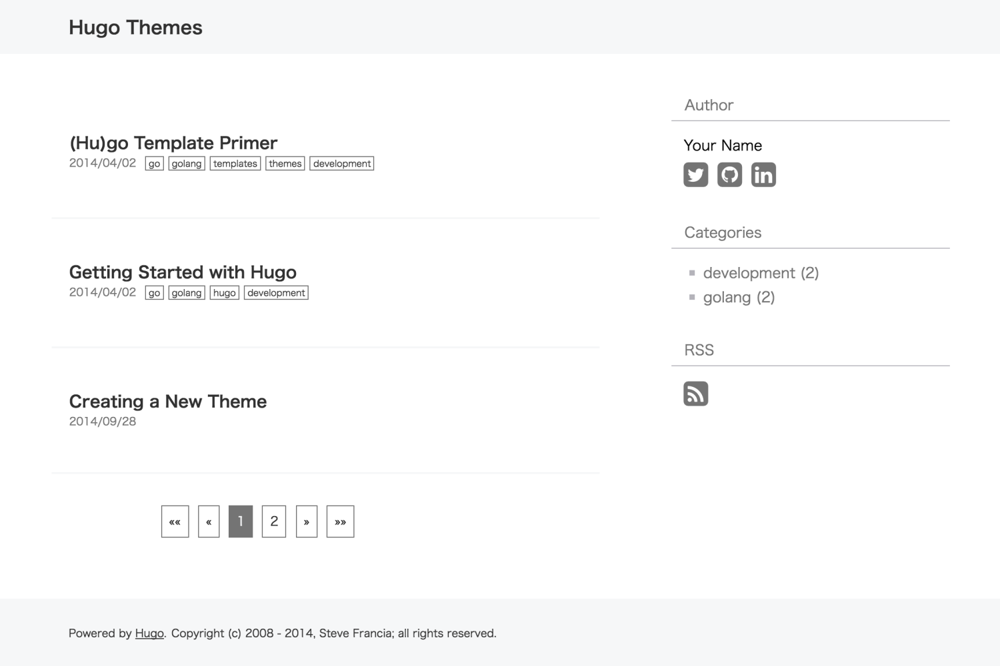
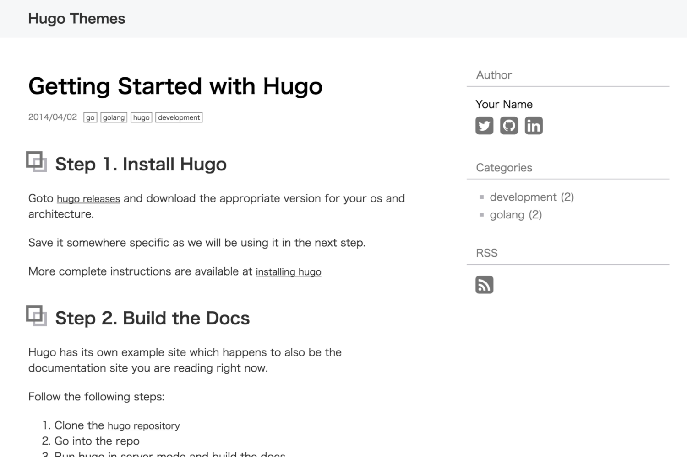

Geppaku
=============================
Geppaku is bluish white theme for [Hugo](http://gohugo.io/).

Note that it is not in the "Seppuku".
I'm not Samurai.

Please check [https://koooge.github.io/hugo-theme-geppaku/](https://koooge.github.io/hugo-theme-geppaku/), if you are interested in this theme.

## Screenshot
### Index page


### Post page


## Installation

```
$ mkdir themes
$ cd themes
$ git clone https://github.com/koooge/hugo-theme-geppaku hugo-theme-geppaku
```
See the Hugo documentation for more information.


## Config

Example of config.toml file:
```toml
baseurl = "http://your-site-here/"
locale = "en-us"
title = "your site title"
theme = "hugo-theme-geppaku"
googleAnalytics = ""
disqusShortname = ""
# enableRobotsTXT = true

[services.rss]
    limit = 15

[params]
    # In display order; available: x_twitter, facebook, hatena, tumblr, bluesky.
    sharebuttons = ["x_twitter", "bluesky"]
    # Required only when "facebook" is included in sharebuttons.
    # facebookAppId = "your app id"

[params.author]
    name = "Your name"

    # Author links appear in the order listed below.
    socials = [
        { service = "x_twitter", id = "your x id" },
        { service = "linkedin", id = "your linkedin id" },
        { service = "github", id = "your github id" },
        { service = "tumblr", id = "your tumblr id" },
        { service = "bluesky", id = "your bluesky id" },
    ]

    [params.adsense]
        # If you want to display Google adsense set these
        # This is Optional values
        # 1. Create file written of the adsense tag into the directory "layouts/partials"
        # 2. Please set file path name omitted "layouts/partials"
        sidebar = "adsense/sidebar.html"
        content = "adsense/content.html"
```
You can delete optional parameter.
Please delete unnecessary parameter.

- :white_check_mark: [Multilingual Mode](https://gohugo.io/content-management/multilingual/)

### Post

Create markdown file:
```sh
hugo new post/2016/05/hello-hugo.md
```

Example of the markdown file:
```md
+++
date = "2016-04-30T16:44:45+09:00"
draft = false
title = "Hello Hugo!"
slug = "hello-hugo"
categories = ["tech"]
tags = [
  "hugo",
  "golang",
  ]
+++
Hello Hugo!
```

## Mathematics

Hugo renders LaTeX expressions to MathML at build time, without client-side
JavaScript or external stylesheets. Enable the passthrough extension in your site
configuration:

```toml
[markup.goldmark.extensions.passthrough]
    enable = true
    [markup.goldmark.extensions.passthrough.delimiters]
        block = [['\[', '\]'], ['$$', '$$']]
        inline = [['\(', '\)']]
```

Use `\( ... \)` for inline math and `$$ ... $$` or `\[ ... \]` for display math.
Single dollar signs remain ordinary text, so prices are not interpreted as math.
Expressions must be supported by Hugo's embedded KaTeX engine; invalid
expressions fail the build.

## Preview

```sh
hugo server --configDir ./exampleSite/config --config ./exampleSite/config/test/config.toml --themesDir ./ --layoutDir ./layouts --contentDir ./exampleSite/content
```
