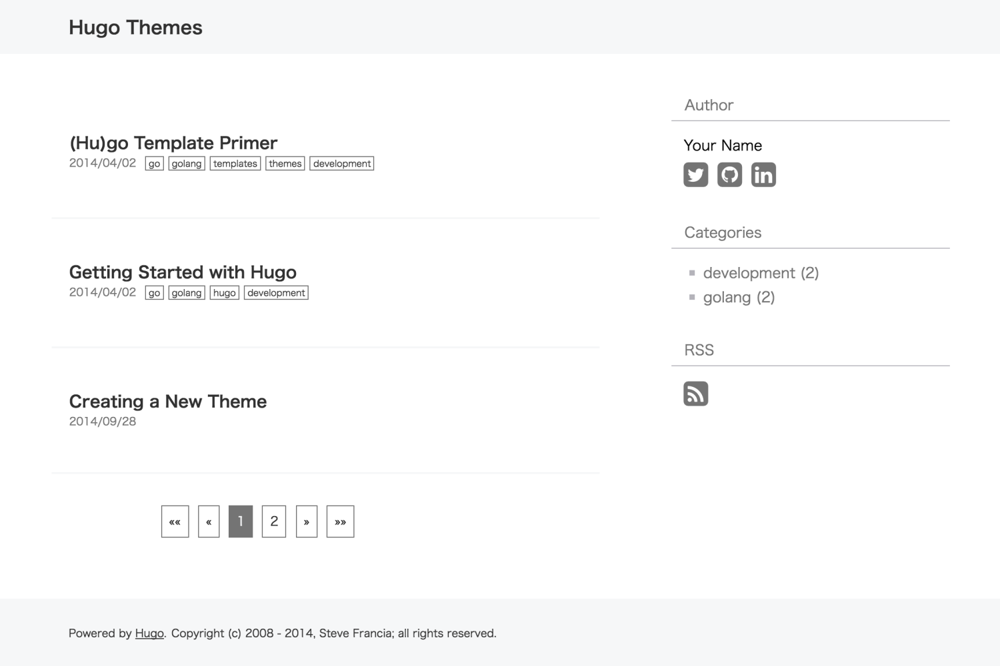
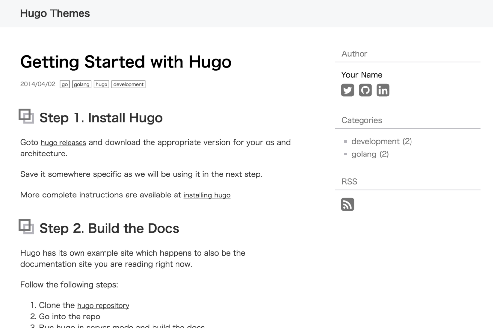

+++
date = "2016-05-03T11:03:05+09:00"
draft = false
title = "月白のインストール方法"
slug = "how-to-install-geppaku-theme"
categories = ["technology"]
tags = [
  "Hugo",
  "Hugo theme",
  ]
+++
Geppaku is bluish white theme for [Hugo](http://gohugo.io/).
It is color name in Japan. Chinese character is "月白".

> 月白（げっぱく）とは、月の光を思わせる薄い青みを含んだ白色のことです。
<small>via http://irocore.com/geppaku/</small>

Geppaku is the white color including a thin blue that reminiscent of the light of the moon.
(If that translate is wrong, please inform me using PullRequest.)

## Screenshot
### Index page


### Post page



## Installation

```
$ mkdir themes
$ cd themes
$ git clone https://github.com/masa0221/hugo-theme-geppaku hugo-theme-geppaku
```
See the Hugo documentation for more information.


### Config

Example of config.toml file:
```toml
baseurl = "http://your-site-here/"
locale = "en-us"
title = "your site title"
theme= "hugo-theme-geppaku"
googleAnalytics = "" # Optional
disqusShortname = "" # Optional

[services.rss]
    limit = 15

[params]
    # Share buttons appear in this order. Use [] to hide all buttons.
    sharebuttons = ["x_twitter", "bluesky"]
    # Required only when "facebook" is included in sharebuttons.
    # facebookAppId = "your app id"

[params.author]
    name = "Your name"

    socials = [
        { service = "x_twitter", id = "your x id" },
        { service = "linkedin", id = "your linkedin id" },
        { service = "github", id = "your github id" },
        { service = "bluesky", id = "your bluesky id" },
        { service = "slideshare", id = "your slideshare id" },
    ]

    [params.adsense]
        # If you want to display Google adsense set these
        # This is Optional values
        # 1. Create file written of the adsense tag into the directory "layouts/partials"
        # 2. Please set file path name omitted "layouts/partials"
        sidebar = "adsense/sidebar.html"
        content = "adsense/content.html"
```
You can delete optional parameter.
Please delete unnecessary parameter.


### New Post
#### Create markdown file
```sh
hugo new post/2016/05/hello-hugo.md
```

#### Example of the toml file

```
+++
date = "2016-04-30T16:44:45+09:00"
draft = false
title = "Hello Hugo!"
slug = "hello-hugo"
categories = ["tech"]
tags = [
  "hugo",
  "golang",
  ]
+++
Hello Hugo!
```
